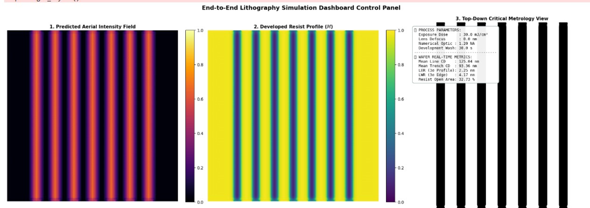
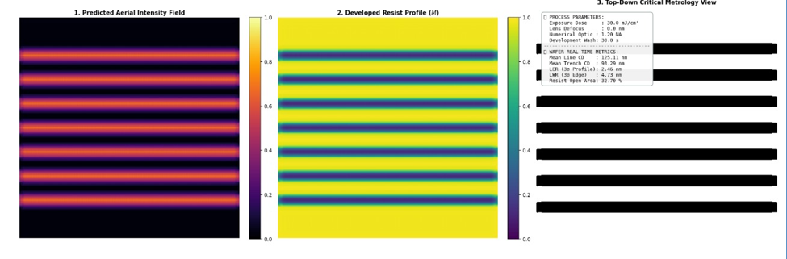
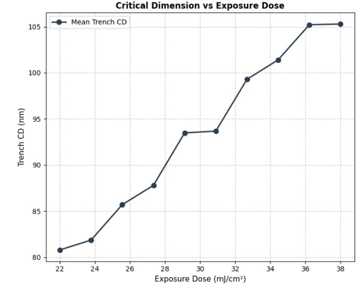
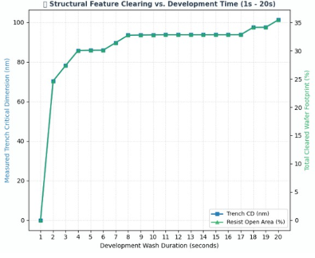

## 🔬 End-to-End Pipeline Validation & Parameter Sweeps

To validate the synchronized operation of the dual-stage U-Net architecture and the Mack dissolution engine, the complete offline inference pipeline was executed across varying mask topologies and process extremes.

### Real-Time Layout Dashboards
The pipeline successfully translates the optical diffraction field, through the chemical protection matrix, to the final volumetric binary inspection grid. The inference dashboards below demonstrate this continuous metrology extraction for sub-100nm Vertical Gratings, Horizontal Gratings, and 2D Contact Hole Arrays.

**Vertical Grating Layout**

**Horizontal Grating Layout**

---

### Macro-Physical Process Validation (Parameter Sweeps)
To ensure the neural network surrogate mathematically aligns with textbook lithographic physics, parameter sweeps were conducted for Exposure Dose and Development Time. 

> **Note:** Line Edge Roughness (LER) measurements were explicitly excluded from this physical validation. Because our model utilizes a deterministic 512x512 coordinate grid, any observed "roughness" is a digital discretization artifact rather than true stochastic photon shot noise.

* **Critical Dimension vs. Exposure Dose:** As the exposure dose increases, the U-Net accurately predicts a wider photoacid generation footprint. This results in a broader trench Critical Dimension (CD), successfully mirroring Dill’s kinetic law of photolysis.
* **Critical Dimension vs. Development Time:** As wash time increases, the Mack dissolution engine computes deeper and wider etching profiles. The extracted CD expansion trends perfectly match the theoretical non-linear threshold response of the alkaline developer fluid.

**CD Validation Plots**

---
